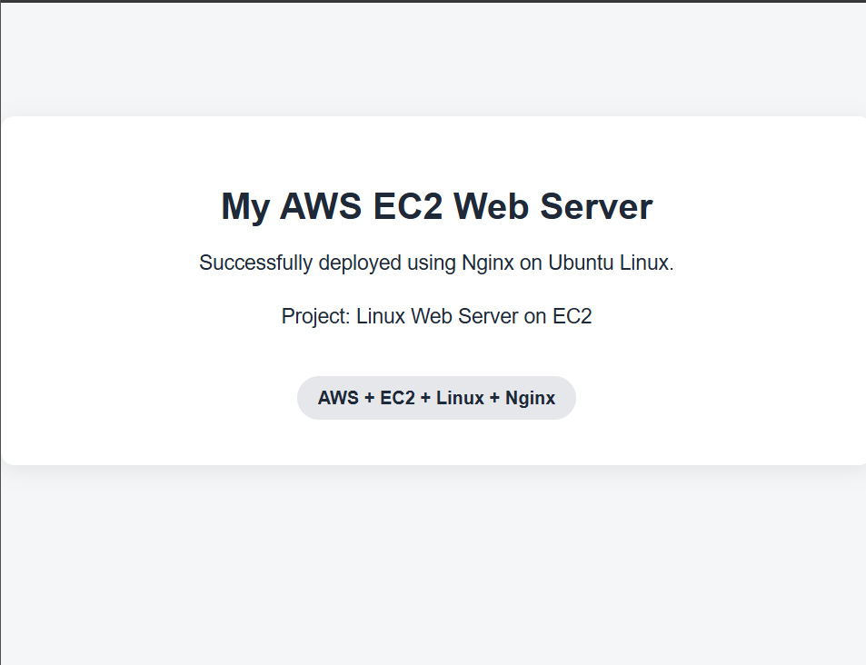

# Linux Web Server on AWS EC2

A simple static website hosted with Nginx on an Ubuntu EC2 instance.



## Stack

AWS EC2 (Ubuntu 24.04, t3.micro) · Nginx · HTML

## Setup

1. Launch an Ubuntu EC2 instance. In the Security Group, allow SSH (22) from your IP and HTTP (80) from anywhere.
2. Connect:
   ```bash
   ssh -i linux-web-server-key.pem ubuntu@<PUBLIC-IP>
   ```
3. Install Nginx:
   ```bash
   sudo apt update && sudo apt install nginx -y
   ```
4. Deploy the site:
   ```bash
   sudo cp website/index.html /var/www/html/index.html
   ```
5. Open `http://<PUBLIC-IP>` in a browser.

## Project Structure

```text
website/index.html    # the web page
nginx/default.conf    # Nginx site config
docs/commands.md      # Linux & Nginx commands used
screenshots/          # screenshots
```

## Troubleshooting

```bash
sudo systemctl status nginx              # is Nginx running?
sudo ss -tulpn | grep :80                # is port 80 open?
sudo nginx -t                            # is the config valid?
sudo tail -n 20 /var/log/nginx/error.log # any errors?
```

## Author

Ankit Lakra
